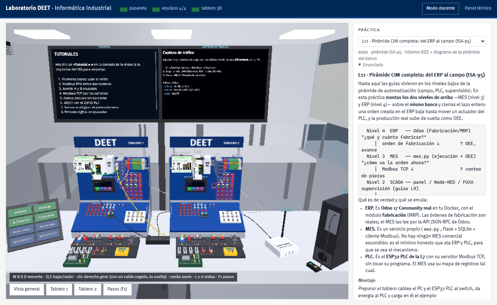
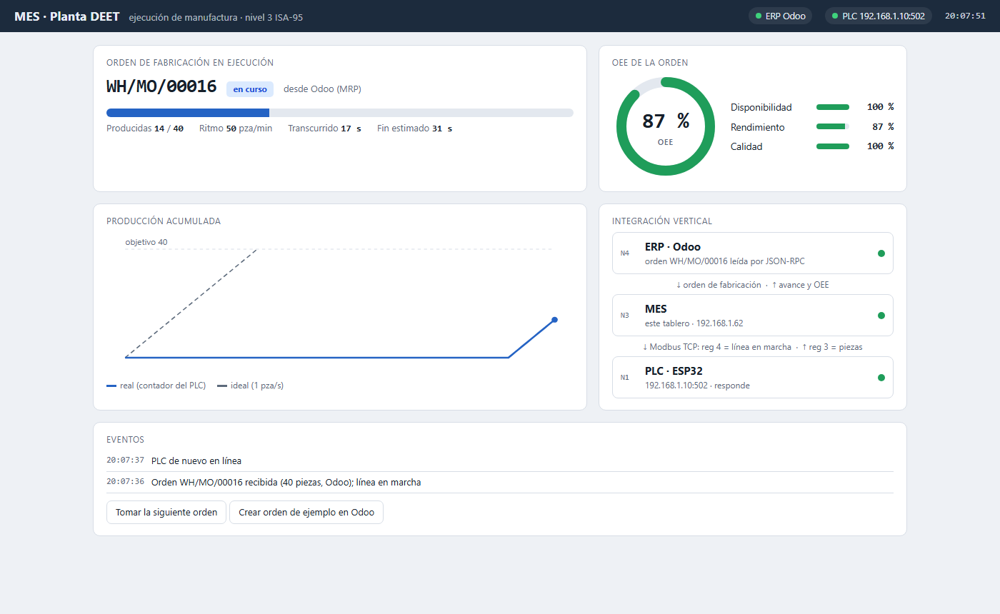
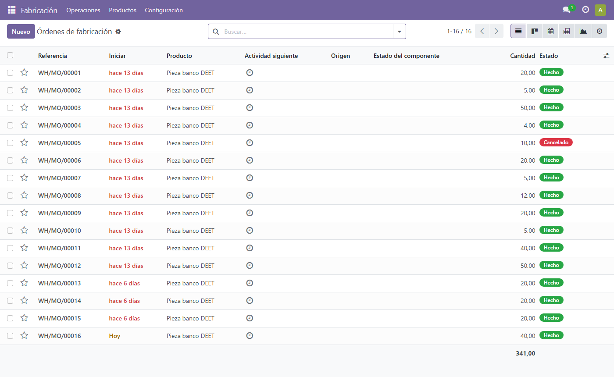
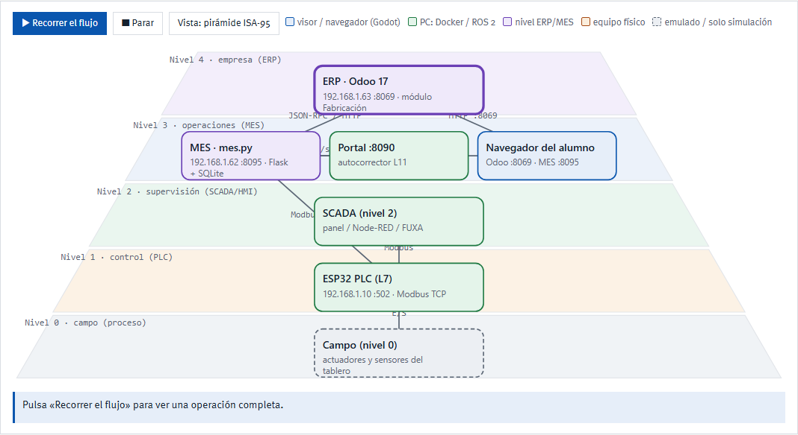
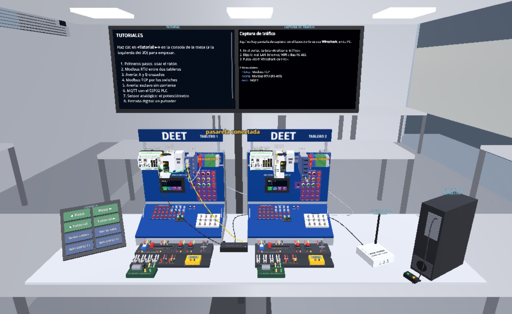

<h1 align="center">Banco virtual de Informática Industrial</h1>
<p align="center"><b>Universidad de Cuenca · DEET</b><br>
El tablero de comunicaciones del laboratorio, completo, en tu computador.</p>

<p align="center">
  
  
  
  
</p>



## Qué es

Un **gemelo digital del banco de comunicaciones industriales** del laboratorio: dos tableros con **Controllino MEGA**, **ESP32 PLC**, switch, HMI STONE, bornera, módulos (potenciómetro, DHT11, pulsadores, motor, foco) y una pasarela LoRaWAN.

Lo usas desde el navegador: armas cables en el **tablero 3D**, programas los equipos con tus `.ino` (o en escalera) y un **autocorrector** comprueba cada guía.

- **Los protocolos son reales.** Modbus TCP y RTU, MQTT, OPC UA, PROFINET y LoRaWAN corren en contenedores Docker. Cuando enchufas un cable en el 3D, se ejecuta de verdad un `docker network connect`, y lo ves en **Wireshark**.
- **Tu programa corre de verdad.** Tu `.ino` se compila con `g++` contra un núcleo Arduino propio y se ejecuta como proceso, con el mismo mapa de pines que el equipo físico.
- **Toda la pirámide.** Del sensor al ERP: PLC, SCADA (Node-RED, FUXA), un MES propio y **Odoo** (ERP real).
- **No toca la planta física.** Nada de lo que hagas aquí escribe en equipos del laboratorio.

## Qué se simula y qué es real

| Pieza | En el banco virtual |
|---|---|
| Controllino y ESP32 PLC | Tu `.ino` compilado y ejecutado en un contenedor, con E/S, relés, Modbus y serie emulados |
| Cables, switch y redes | Redes Docker reales; cada switch es su propia red |
| Modbus TCP/RTU, MQTT, OPC UA, LoRaWAN | Protocolos reales sobre esas redes: se capturan con Wireshark |
| HMI STONE | Emulada, con sus widgets y su protocolo serie |
| ERP (Odoo 17) | Real |
| MES | Propio y mínimo, para ver el mecanismo (Flask + SQLite + Modbus) |
| Potenciómetro, motor, foco, pulsadores | Módulos del 3D, conectados por tus hilos |

## Las guías

| Guía | Tema |
|---|---|
| **LIBRE** | Laboratorio libre: arma y prueba tu propia topología |
| **L0** | Reconocimiento del banco de control |
| **L1** | E/S digitales, rebote y máquina de estados |
| **L2** | HMI industrial STONE y motor con encoder (EPC) |
| **L3** | Comunicación serial RS-485 con tramas propias |
| **L4** | Captura y análisis de tráfico (Wireshark + Docker) |
| **L5** | Planificación de red (GNS3 / Sinetplan / red emulada) |
| **L6** | Modbus RTU maestro-esclavo sobre RS-485 |
| **L7** | Modbus TCP por Ethernet |
| **L8** | PROFINET: anatomía, disección y generación de tramas |
| **L9** | WiFi industrial, MQTT y pasarela Node-RED |
| **L10** | IIoT con LoRaWAN (RN2903 · ChirpStack) |
| **U2** | Modelo OSI y acceso al medio |
| **U4** | Comparativa de tramas y selección de protocolo |
| **U6** | Seguridad IEC 62443 sobre el banco |
| **L11** | Pirámide CIM completa: del ERP al campo (ISA-95) |
| **L12** | Comunicación entre tableros: RS-485 y Ethernet entre dos bancos |
| **L13** | OPC UA · nivel de entrada: tu servidor del tablero y UaExpert |
| **L14** | OPC UA con Python: datalogger y termostato del tablero |
| **L15** | OPC UA · control ON/OFF con histéresis y migración de NodeIds |

> Las guías en PDF las da tu docente. Cada práctica trae su enunciado, el montaje y un autocorrector que comprueba el resultado.

## Ejemplo: la pirámide completa (L11)

Una orden de fabricación creada en el **ERP** baja por el **MES** hasta el **PLC**; la producción real sube de vuelta como OEE. En el tablero se ve en las salidas del PLC: foco de línea en marcha, lámparas de avance (1/3 y 2/3) y el **motor de la cinta**, que gira mientras se fabrica.

| MES (nivel 3) | ERP · Odoo (nivel 4) |
|---|---|
|  |  |



## Instalar

**Necesitas:** Windows 10 u 11, [Docker Desktop](https://www.docker.com/products/docker-desktop/) abierto («Running»), 20 GB libres e internet la primera vez.

**Opción A: con Git**

```powershell
git clone https://github.com/jeanaucapina/Practicas-Banco-Deet banco
cd banco
Set-ExecutionPolicy -Scope CurrentUser RemoteSigned   # una sola vez
.\lab.ps1 navegador
```

**Opción B: con el ZIP de GitHub** (*Code → Download ZIP*): descomprime y haz **doble clic en `iniciar.cmd`**. No hace falta tocar la seguridad de PowerShell.

Se abre **http://localhost:8090/lab**. La primera vez tarda entre 10 y 30 minutos (construye las imágenes); después, menos de un minuto.

| Para… | Orden |
|---|---|
| Abrir el laboratorio | `.\lab.ps1 navegador` (o doble clic en `iniciar.cmd`) |
| Ver qué está corriendo | `.\lab.ps1 estado` |
| Apagar todo | `.\lab.ps1 parar` |
| Abrir Wireshark con la captura en vivo | `.\lab.ps1 wireshark` |
| Actualizar | `git pull` y de nuevo `.\lab.ps1 navegador` (Ctrl+Shift+R en el navegador) |

## Primeros pasos

1. En **Práctica**, elige una guía (p. ej. **L0**).
2. **Preparar el tablero**: pone los cables y la energía de esa práctica.
3. Arma lo que pide el enunciado en el **tablero 3D** y programa el equipo (**Subir un programa .ino** o **Programar en escalera**).
4. **Comprobar mi solución**: el autocorrector pulsa, mide y te dice qué paso falla.



**Controles del 3D:** `W A S D` moverte · `Q E` bajar/subir · clic derecho girar (con un cable cogido, lo suelta) · rueda zoom · `1 2 0` vistas · `F1` muestra los pasos de la práctica · `Shift`+clic deja un pulsador enclavado.

## Puertos que usa en tu PC

| Puerto | Servicio |
|---|---|
| 8090 | Portal del laboratorio |
| 8091 | Tablero 3D |
| 7070 | Gafas Quest (pasarela) |
| 6080 · 7681 | OpenPLC Editor · terminal del «PC del banco» |
| 8095 · 8069 | MES · Odoo (práctica L11) |
| 8089 | ChirpStack (práctica L10) |
| 1890 · 1891 | Node-RED · FUXA (práctica L9) |

Están elegidos para convivir con otros laboratorios (ot-lab usa 1880, 1881 y 8088).

## Problemas frecuentes

<details>
<summary><b>«Docker Desktop no está arrancado»</b></summary>

Abre Docker Desktop y espera a que diga *Running*. Vuelve a ejecutar `.\lab.ps1 navegador`.
</details>

<details>
<summary><b>PowerShell dice que la ejecución de scripts está deshabilitada o que no está firmado</b></summary>

Bajaste el ZIP: usa **`iniciar.cmd`** (doble clic). Con Git: `Set-ExecutionPolicy -Scope CurrentUser RemoteSigned`. O: `Unblock-File .\lab.ps1`.
</details>

<details>
<summary><b>El 3D no se actualiza después de un <code>git pull</code></b></summary>

Recarga con **Ctrl+Shift+R**.
</details>

<details>
<summary><b>Tarda mucho la primera vez</b></summary>

Es normal: Docker construye las imágenes del banco. Las prácticas con servidor propio (Odoo, ChirpStack, FUXA) bajan más imágenes al usarlas; el desplegable **Espacio en disco** del portal las baja por adelantado o las suelta al terminar, sin perder tus datos.
</details>

<details>
<summary><b>Un puerto está ocupado</b></summary>

Cierra el programa que lo usa, o apaga el otro laboratorio. Con `.\lab.ps1 estado` ves qué contenedores del banco están corriendo.
</details>

Más detalle: [docs/INSTALACION.md](docs/INSTALACION.md).

---
<sub>Universidad de Cuenca · Departamento de Eléctrica, Electrónica y Telecomunicaciones (DEET). Uso académico.</sub>
