# Tableros de comunicaciones industriales en VR (DEET)

Gemelo de los tableros del laboratorio (Controllino, ESP32 PLC 14, switch,
fuente 24 V, HMI Stone, luminarias, pulsadores, bananas y protoboard) para
practicar redes industriales desde las gafas, **con tráfico real que se
captura en Wireshark** y que también se ve en vivo en la pantalla del PC
dentro de las gafas.

## La idea en una línea

Las gafas son las manos; la red vive en Docker en el PC. Enchufar un
latiguillo en VR ejecuta un `docker network connect` de verdad, y apagar un
equipo con su interruptor lo congela (`docker pause`), así que el ping, el
Modbus y el MQTT que se ven en Wireshark son reales.

```
 Meta Quest 3 (Godot)                      PC del laboratorio (Linux + Docker)
 ┌──────────────────────┐   WiFi, TCP 7070  ┌──────────────────────────────────────────┐
 │ TableroLab.tscn      │ ───────────────▶  │ pasarela.py                              │
 │  2 tableros, cables, │ ◀── estado 10 Hz  │  cable RJ45   → docker network connect   │
 │  pulsadores, HMI,    │    + tramas       │  bananas A/B  → buses RS-485 + polaridad │
 │  pantalla del PC     │                   │  interruptor  → docker pause/unpause     │
 └──────────────────────┘                   │  captura tab-lan y buses → tramas.py     │
                                            │                                          │
                                            │  tab-lan 192.168.10.0/24 (los switches)  │
                                            │   ├ .1   el PC: Wireshark, QModMaster... │
                                            │   ├ .1n  Controllino del tablero n (RTU n)│
                                            │   ├ .2n  ESP32 PLC del tablero n         │
                                            │   └ .50  broker MQTT                     │
                                            │  tab-485  buses RS-485 (UDP 4850-4859)   │
                                            │  tab-wifi 192.168.20.0/24 (WiFi ESP32)   │
                                            └──────────────────────────────────────────┘
```

## Arquitectura, a fondo

El diagrama de arriba es el resumen; este es el detalle de qué hace cada
pieza y, sobre todo, **dónde vive la lógica de cada equipo** (lo que hace
falta saber para responder "¿esto se puede programar de verdad?").

```mermaid
flowchart LR
    subgraph GAFAS["Meta Quest 3 — Godot/GDScript"]
        VR["TableroLab.tscn<br/>solo dibuja y detecta manos/mando:<br/>NUNCA simula un protocolo"]
    end

    subgraph PC["PC del laboratorio"]
        PAS["pasarela.py<br/>TCP 7070 + baliza UDP 7071"]

        subgraph DOCKER["Redes Docker (de verdad)"]
            LAN["tab-lan 192.168.10.0/24"]
            BUS["tab-485 · buses RS-485<br/>(UDP 4850-4859)"]
            WIFI["tab-wifi 192.168.20.0/24"]
        end

        subgraph CTL["Contenedor tab1-controllino"]
            direction TB
            BASE1["base.py<br/>estado 10 Hz, ordenes, bus 485"]
            MB1["modbus_mini.py<br/>Modbus RTU/TCP a bajo nivel"]
            LOG1["controllino.py ← LA LOGICA<br/>modo esclavo / maestro / secuencia<br/>(hoy: Python que imita al Controllino)"]
        end

        subgraph ESP["Contenedor tab1-esp32plc"]
            direction TB
            LOG2["esp32plc.py ← LA LOGICA<br/>esclavo TCP + maestro RTU + MQTT"]
        end

        BROKER["tab-broker (Mosquitto)"]
        SNIFF["sniffer.py<br/>captura tab-lan en crudo"]
        WS["Wireshark / tshark<br/>(en el PC o por ssh)"]
    end

    VR -- "cable, pulsador,<br/>interruptor de energia" --> PAS
    PAS -- "estado 10 Hz + tramas<br/>decodificadas" --> VR
    PAS -- "docker network connect/disconnect<br/>docker pause/unpause" --> DOCKER
    DOCKER --- CTL
    DOCKER --- ESP
    DOCKER --- BROKER
    CTL -- "Modbus RTU (485) / TCP" --> ESP
    ESP -- "MQTT" --> BROKER
    DOCKER -. "trafico real" .-> SNIFF --> WS
```



**Lo importante:** las gafas nunca calculan un CRC ni deciden un valor de
Modbus; eso vive en los contenedores, que son procesos Python normales y
corrientes (`dispositivos/*.py`) hablando por sockets de verdad. Wireshark ve
tráfico real porque **es** tráfico real, no una animación.

### ¿Se puede programar el Controllino "de verdad"?

Hoy `dispositivos/controllino.py` es una **simulación en Python** del mapa
Modbus y del comportamiento del Controllino MEGA (qué hace en modo esclavo,
maestro RS-485/TCP o secuencia) — no ejecuta un sketch de Arduino real. Es
rápido de mantener y ya cubre las prácticas de red (Modbus, RS-485, MQTT), que
es lo que hay hoy en el simulador.

Para que el alumno programe el Controllino de verdad, hay dos caminos, y no
son excluyentes porque la lógica de cada equipo está aislada en su propio
contenedor (cambiar uno no toca cables, cableado ni el resto del simulador):

| Opción | Cómo funcionaría | Encaja con |
|---|---|---|
| **OpenPLC** (recomendado para empezar) | El Controllino/ESP32 pasan a ser esclavos Modbus "tontos" (ya lo son) y el alumno programa el **OpenPLC** de `ot-lab` (ladder o texto estructurado, IEC 61131-3) para que los gobierne por Modbus TCP. `tablero.sh otlab` ya los conecta a la misma red. | Las prácticas de PLC/SCADA que ya están en el temario |
| **arduino-cli + simavr** | Se compila un `.ino` real (código Arduino/Controllino en C++) con `arduino-cli`, y se ejecuta en **simavr** (un emulador del microcontrolador ATmega de verdad, no una imitación): sus pines UART/GPIO se conectan al mismo Modbus/RS-485 que ya existe. El alumno escribe el mismo código que subiría al Controllino físico. | Una práctica dedicada de "programa el Controllino"; más trabajo de integración (hay que puentear los pines emulados con la simulación de bus) |

**Hecho (2026-10-16), por otra vía:** en vez de simavr (no emula el chip Ethernet W5100) se compila el `.ino` con g++ contra un núcleo Arduino propio; vale igual para el ESP32 y la red es real. Uso: [ejemplos_arduino/LEEME.md](ejemplos_arduino/LEEME.md); detalles: [dispositivos/arduino/LEEME.md](dispositivos/arduino/LEEME.md).

Mi recomendación: dejar `controllino.py` tal cual para las prácticas de red
(es lo que ya está probado), **sumar OpenPLC ahora** como cerebro alternativo
para las prácticas de PLC (ya está integrado, es cuestión de apuntar el driver
Modbus del proyecto OpenPLC a `192.168.10.1n`), y dejar simavr como mejora
futura si hace falta código Arduino de verdad. Dime cuál prefieres y lo dejo
armado.

## Arranque

```bash
cd tablero
./tablero.sh arrancar      # equipos + pasarela; imprime IPs y comandos útiles
./tablero.sh estado
./tablero.sh parar
```

Solo necesita Docker y Python 3; los equipos usan `python:3.12-slim` sin
instalar nada (Modbus y MQTT están escritos a mano en `dispositivos/` para
que se puedan leer).

- **Escritorio:** `godot4 --xr-mode off --path godot res://scenes/TableroLab.tscn`
- **Quest:** app **"Tablero DEET"** (`build/tablero_quest.apk`, preset "Quest Tablero").
  Encuentra el PC sola por la WiFi. Si la red lo impide, por cable USB:
  `adb reverse tcp:7070 tcp:7070`.

## Práctica 1: Modbus entre dos tableros

1. **Cableado:** botón *Cableado práctica* (o hacerlo a mano). Cada PLC va a su
   switch, y el RS‑485 del Controllino 1 al del Controllino 2: banana **A con A** y
   **B con B**, en la última fila de la bandeja.
2. **Maestro:** en la HMI del **tablero 1**, **MAESTRO 485** (Modbus RTU) o
   **MAESTRO TCP** (Modbus TCP por los switches).
3. **Prueba:** los pulsadores **I16, I17 e I18** del tablero 1 encienden las filas de
   la matriz del tablero 2 (D0 D6 D12 / D1 D7 D13 / D2 D8 D14).
4. **Observación:** en la pantalla del PC, o en Wireshark, se ve el FC15 con los
   bits cambiando al pulsar.

Para ver los fallos típicos:

- **A y B cruzados:** el maestro pregunta y nadie responde ("sin respuesta"): el
  esclavo recibe los bits invertidos. Las peticiones se leen bien en la captura
  porque el maestro es la referencia de polaridad; "CRC MAL" solo sale si el
  invertido es quien transmite (p. ej. el adaptador USB-RS485 del PC cruzado).
- **Controllino 2 apagado** (su interruptor): el maestro pasa a "sin respuesta".
- **Latiguillo quitado en modo TCP:** se ve el RST o el FIN de la conexión.

## Con ot-lab (github.com/Pbarbecho/ot-lab)

ot-lab (OpenPLC, Ignition, FUXA, Node-RED, OPC UA, Conpot, Mosquitto) vive en
`172.28.0.0/24` y los tableros en `192.168.1.0/24`: corren a la vez **sin hacer nada**. La
pasarela enchufa sola sus contenedores al segmento del banco en cuanto aparecen. Puertos:

| Puerto | ot-lab | banco | Convivencia |
|---|---|---|---|
| 1880 | node-red | — | el Node-RED del banco va en el **1890** |
| 1881 | fuxa | — | el FUXA del banco va en el **1891** |
| 8088 | ignition | — | ChirpStack de la L10 pasó al **8089** |
| 172.28.0.0/24 | red ot-lab | `planta_net` de la L4 | con ot-lab arriba, la L4 usa 172.27.0.0/24 |

```powershell
cd ot-lab; docker compose up -d           # como dice su README
.\lab.ps1 navegador                       # el banco
.\lab.ps1 otlab                           # opcional: los enchufa ya (lo automatico lo hace en <10 s)
.\lab.ps1 otlab quitar                    # los desenchufa y desactiva lo automatico
```
(En Linux: `./tablero.sh otlab` / `otlab-quitar`.)

| Contenedor de ot-lab | IP en el segmento del banco |
|---|---|
| openplc | 192.168.1.200 |
| ignition | .201 |
| fuxa | .202 |
| node-red | .203 |
| mosquitto | .204 |
| modbus-sim | .205 |
| opcua-py | .206 |
| opc-plc | .207 |
| conpot | .208 |

Con eso, en Ignition o FUXA se da de alta un dispositivo Modbus TCP en
`192.168.1.11:502` (Controllino del tablero 1) o `192.168.1.10:502` (ESP32 PLC). Su
Node-RED lee el broker del banco, `192.168.1.50` (alias `mosquitto_broker`), que es el
que comprueba el autocorrector de la L9. Como no pasan por un switch del tablero, ven a
los dos tableros (como un servidor del laboratorio). Ese tráfico sale en Wireshark con el
nombre de cada servicio. Si el portal pide «Encender Node-RED» con el de ot-lab corriendo,
abre ese (1880).

## Mapeo del tablero (etiquetas `DiseñoTablero/Etiquetas_*-Modelo.pdf`)

**Panel medio, placa CONTROLLINO**, a la derecha de la HMI:

```
        D0  D6  D12  [I16]        luminarias 3x3 + pulsadores
        D1  D7  D13  [I17]
   GND  D2  D8  D14  [I18]
        D3  D9  D15  D18          bananas de salida
        D4  D10 D16  D19
        D5  D11 D17  D20
```

**Panel posterior de controles**, junto a la toma de 220 VAC: los
interruptores de energía SWITCH, HMI, ESP32 PLC, CONTROLLINO y FUENTE AC/DC.
La fuente corta todo el tablero; para llegar a ellos, rodea la mesa o gírala
con los dos gatillos.

**Bandeja**, bananas a 20 mm. Pulsar una banana de entrada le pone un puente desde 24 V:

```
   A0  A1  A2  A3  | I0.1 I0.2 I0.3 I0.4 | GND 5V
   A4  A5  A6  A7  | I0.5 I0.6 I0.7 I0.8
   A8  A9  A10 A11 | Q0.0 Q0.1 Q0.2 Q0.3
   A12 A13 A14 A15 | IN0  IN1  A    B        (A/B = RS-485 del Controllino)
```

El RS‑485 del ESP32 sale por su propia bornera (A, B), en el equipo. El
adaptador USB‑RS485 del PC está junto al PC (`run/ttyTAB485` para QModMaster).

## Mapa Modbus

**Controllino** (mapa de E/S del MEGA, que es el de las etiquetas): TCP
`192.168.10.1n:502`, esclavo RTU `n`.

| Tabla | Direcciones | Qué es |
|---|---|---|
| Bobinas | 0–23 | D0–D23 |
| Bobinas | 24–39 | relés R0–R15 |
| Discretas | 0–15 | A0–A15 |
| Discretas | 16–18 | pulsadores I16–I18 |
| Discretas | 19–20 | IN0, IN1 |
| Reg. entrada | 0–15 | A0–A15 (0–1023) |
| Reg. entrada | 16 | segundos encendido |
| Holding | 0 | MODO: 0 esclavo · 1 espejo · 2 secuencia · 3 maestro RS‑485 · 4 maestro TCP |
| Holding | 1 | periodo de la secuencia [ms] |
| Holding | 2 | dirección RTU propia |
| Holding | 3 | tablero/esclavo remoto |
| Holding | 4 | peticiones OK del maestro |
| Holding | 5 | peticiones sin respuesta |

**ESP32 PLC 14**: TCP `192.168.10.2n:502`, maestro RTU opcional y MQTT.

| Tabla | Direcciones | Qué es |
|---|---|---|
| Bobinas | 0–3 | Q0.0–Q0.3 |
| Bobinas | 4 | relé R0 |
| Discretas | 0–7 | I0.1–I0.8 |
| Reg. entrada | 0 | sensor 4–20 mA de temperatura simulado |
| Holding | 0 | maestro RTU on/off |
| Holding | 1 | esclavo a sondear |
| Holding | 2 | periodo del sondeo |
| Holding | 10–14 | lo leído del esclavo |

**MQTT:**

- Publica `tableroN/esp32plc/estado` cada segundo.
- Obedece `tableroN/esp32plc/set/Q0.0` … `R0` con `1` o `0`.
- Hace de pasarela Modbus TCP → MQTT: lee el Controllino de su tablero y publica
  `tableroN/controllino/estado` (pulsadores I16–I18, A0–A15, D0–D23 y MODO). Lo
  publica al cambiar algo y cada 2 s.

## Tutoriales dentro de las gafas

La pantalla grande, encima de los tableros, tiene a la izquierda el tutorial y
a la derecha la misma captura que el PC. Se manejan desde la **CONSOLA**, el
atril a la izquierda de la mesa: «Tutorial ►», «◄ Paso» y «Paso ►». Cada paso
es una sola acción y **se da por hecho solo** cuando el equipo real (Docker)
lo refleja; una flecha naranja señala qué tocar. Son ocho:

1. Primeros pasos: tocar con la yema, pellizcar y enchufar, arrastrar el potenciómetro y quitar un cable.
2. Modbus RTU entre dos tableros.
3. Avería: A y B cruzados.
4. Modbus TCP por los switches.
5. Avería: esclavo sin corriente.
6. MQTT con el ESP32 PLC.
7. Sensor analógico: el potenciómetro (alimentarlo y leerlo en AI-1).
8. Entrada digital: un pulsador suelto a DI-1.

Están en `godot/scripts/tutoriales_tablero.gd`. `godot/pruebas/tablero_tutoriales.gd`
los recorre enteros contra la pasarela real.

## Módulos: arma tu propio escenario

Cada tablero tiene, sobre la mesa, un bloque de expansión **MÓDULOS** (junto a
la bandeja de bananas) con bornes neutros — **AI‑1, AI‑2, AI‑3** (analógicos),
**5V**, **DI‑1…DI‑4** (digitales) y **Q‑1…Q‑4** (lectura de las salidas
Q0.0–Q0.3) — y, en una regleta elevada delante del tablero, cuatro módulos con
**sus hilos reales, del color de su función** (VCC rojo, GND negro, señal
amarillo), sin enchufar a nada:

- **DHT11**: VCC, DATA, GND. DATA a un AI da la temperatura.
- **Potenciómetro deslizante** de 9 cm, continuo (0–100 %): VCC, GND, SEÑAL. Se arrastra con la yema, el pellizco, el rayo o el ratón.
- **2 pulsadores extra** (`EXTRA1`, `EXTRA2`): V+ y SEÑAL.
- **Motor pequeño**: + a un Q‑x y − a GND; gira mientras esa salida esté a 1.

La práctica es cablearlos como en la realidad: **alimentación primero** (rojo
al 5V de la bandeja o del bloque MÓDULOS, negro al GND de la bandeja) y la
señal al borne que se quiera. Sin alimentar, el módulo no funciona: el
potenciómetro y el DHT11 leen 0, el pulsador no llega al DI y el motor no gira.
Los cables se apoyan sobre la mesa, no la atraviesan.

Por dentro no son hardware nuevo: cada borne **AI‑x**, **DI‑x** y **Q‑x** es
sencillamente un registro Modbus del ESP32 PLC 14 que ya existía sin usar
(entradas analógicas 1–3, I0.1–I0.4 y Q0.0–Q0.3), así que lo que lean el DHT11
o el potenciómetro sale por Modbus/MQTT exactamente igual que un sensor real
(ver [dispositivos/esp32plc.py](dispositivos/esp32plc.py)). El DHT11 real
habla un protocolo digital de un solo hilo; aquí su DATA se lee en un AI como
temperatura, sin decodificar ese protocolo. Los colores I2C (SDA azul, SCL
verde) están reservados en el código para cuando haya un sensor I2C.

Estos cables son "de mentira" a propósito: no pasan por Docker ni se ven en
Wireshark (no hay hardware real detrás), solo cambian registros dentro del
contenedor — a diferencia de los cables Ethernet/RS-485, que si son enchufes
de red reales.

## Ver las tramas

**Dentro de las gafas:** la pantalla del PC del laboratorio muestra en vivo:

- **Tramas de `tab-lan`:** Modbus TCP (MBAP y PDU), MQTT, ARP, ping y la apertura y
  cierre TCP.
- **Tramas de los buses RS‑485:** Modbus RTU con comprobación de CRC.
- **Desglose de la última trama**, por campos.
- **Filtros:** Todo, Modbus, RS‑485, MQTT y TCP, más **Pausa** para congelar la lista.

El PC está pegado al tablero 2 (antes estaba lejos y la pantalla se veía
borrosa) y la pantalla se repinta cada 0,4 s en vez de a los 10 Hz reales de
la red: a esa velocidad no se alcanzaba a leer. La trama más nueva de la
lista se marca con **»** para verla de un vistazo sin tener que leer la hora;
con **Pausa** se congela para estudiarla con calma.

**En Wireshark:**

```bash
wireshark -k -i tab-lan                          # si estás en el grupo wireshark
./tablero.sh capturar tab-lan | wireshark -k -i - # sin permisos
./tablero.sh capturar tab-485 bus.pcap            # a fichero
```

Desde **otro PC**:

```bash
ssh usuario@pc-tablero ros2_godot_robot_starter/tablero/tablero.sh capturar tab-lan \
  | wireshark -k -i -
```

Los buses RS‑485 viajan como datagramas UDP de difusión, un puerto por bus
(4850, 4851…). En Wireshark: *Decode As… → UDP 4850 → Modbus RTU*.

## Manejo

| | Mando | Manos | Ratón |
|---|---|---|---|
| Sacar cable | rayo + gatillo, arrastrar | pellizcar **junto** al puerto y arrastrar | clic |
| Enchufar | soltar el gatillo sobre el puerto | abrir los dedos sobre el puerto | clic |
| Soltar en el aire | la clavija queda colgando | la clavija queda colgando | clic en el vacío: fuera |
| Pulsadores I16–I18 | apretados mientras el gatillo está pulsado | apretados mientras el dedo está dentro | mientras el botón está abajo |
| (toque corto) | el pulsador queda apretado al menos 0,8 s para que se vea la fila del otro tablero | ídem | ídem |
| Bananas de entrada, interruptores, HMI | rayo + gatillo | toque con la yema del índice | clic |
| Mover la mesa | los dos gatillos 3 s | los dos pellizcos 3 s | — |
| Ver la sala (passthrough) | **Y** del mando izquierdo, o botón "Ver la sala" de la consola | tocar "Ver la sala" en la consola | — |

La app arranca con la sala a la vista (para no chocarse con los muebles) y recuerda
la última elección.

## Ficheros

| Ruta | Qué es |
|---|---|
| `docker-compose.yml` | dos tableros (tab1-*, tab2-*), broker y redes |
| `dispositivos/` | Controllino, ESP32 PLC, Modbus y MQTT mínimos |
| `pasarela/pasarela.py` | gafas ↔ Docker; guarda el cableado en `run/cableado.json` |
| `pasarela/tramas.py` | decodificador de tramas para la pantalla del PC |
| `herramientas/capturar.sh` | captura sin grupo wireshark |
| `tablero.sh otlab` | conecta los contenedores de ot-lab a la LAN de los tableros |
| `DiseñoTablero/` | CAD del tablero real (Inventor, STEP, DWG, PDF, etiquetas) |
| `../godot/scenes/TableroLab.tscn` | la escena VR |
| `../godot/models/tablero/` | Controllino (con sus 19 LED), switch, luminaria, carril y toma AC |

**Modelos 3D:**

- **Controllino MEGA:** sale de `DiseñoTablero/CONTROLLINO MEGA PURE.step` (GrabCAD),
  aligerado a unos 56 mil triángulos.
  - Sus 35 guías de luz se encienden con el estado: las 24 primeras con D0–D23 y el
    resto con A0–A10.
  - El orden es por filas del modelo, porque el STEP no dice qué serigrafía tiene
    cada una.
- **ESP32 PLC 14:** sale de `DiseñoTablero/14_IOs.stp` (caja completa), a unos
  66 mil triángulos.
  - En el STEP, +Z es el frente, −Z el clip DIN y las borneras quedan en ±X.
  - La carcasa, que en el STEP es azul claro, se pinta gris como el equipo real.
- **Cómo se convirtieron:** con `cascadio` (STEP a GLB) y `trimesh`. Se sueldan los
  vértices y se diezma **pieza a pieza**; diezmar las piezas juntas abre huecos.


**Medidas:**

- **Origen:** `DiseñoTablero/Ensamble_Tablero.dwg`, leído con LibreDWG, con
  escala 1:1 comprobada con el paso del carril DIN.
- **Dimensiones:** 402 × 403 × 258 mm.
- **Dónde se ajustan:** en las constantes al principio de
  `godot/scripts/tablero_lab.gd`.

**Rótulo DEET:**

- **Fuente pedida:** Meta Pro Bold, que es comercial y no se incluye.
- **Para usarla:** copiar `MetaPro-Bold.otf`, con licencia, a `godot/fonts/`.
- **Mientras tanto:** se usa Fira Sans Bold (licencia OFL), del mismo diseñador.

**Pendiente:**

- **Programar el Controllino:** con código Arduino, compilado con arduino‑cli y
  ejecutado en simavr, o con OpenPLC.
- **Protocolos:** CAN e I2C en la protoboard, y OPC UA.

## S7-1200 simulado (Siemens, S7comm)

Contenedor `tab-s7` ([dispositivos/s7.py](dispositivos/s7.py)), un servidor Snap7 que habla **S7comm de verdad** (ISO-on-TCP, puerto 102).

**Dónde está:**
- En la LAN del tablero: `192.168.10.40`.
- Desde el PC: `127.0.0.1:102` (rack 0, slot 1). Ese tráfico entra a la LAN por 192.168.10.1 y aparece en la pantalla del PC de las gafas como "S7comm".

**Qué hace:**
- Lleva un programa fijo: marcha/paro de una cinta, contador de piezas y temperatura con alarma enclavada.
- El mapa de memoria (`%IB0`, `%QB0`, `DB1 "Proceso"`, marcas) está en la cabecera de `s7.py`.
- No ejecuta programas de TIA Portal: sirve para practicar **clientes S7**, como SCADA/HMI, Node-RED (`node-red-contrib-s7`) o `python-snap7`. El ejemplo está en [ejemplos_s7/cliente_s7.py](ejemplos_s7/cliente_s7.py).

**Lección incluida:** si escribes el byte `DBB0` entero para dar un pulso, pisas los otros 7 bits; hay que escribir **un solo bit**.

**Contra un S7-1200 real**, en TIA Portal:
- habilita PUT/GET en la CPU;
- desactiva el "acceso optimizado" del DB.

## Panel del laboratorio en el PC

`.\lab.ps1 arrancar` abre **<http://localhost:8090>** (solo desde este PC): todo el tablero en una página.

- **En vivo:** E/S de los dos Controllino y ESP32 (pulsadores, potenciómetro, modo y WiFi se manejan desde la página), captura de tramas con filtros, mensajes MQTT, S7-1200 y las CPUs de OpenPLC.
- **Programar:** subir un `.ino` o `.st` a cada equipo (con los errores del compilador), monitor serie, editor gráfico de OpenPLC y guías.
- **Cómo funciona:** el panel (`panel/panel.py`, contenedor `tab-panel`) se conecta a la pasarela como unas gafas más y usa el socket de Docker para compilar y reiniciar equipos. El panel y las gafas pueden estar a la vez.

## Versión en el navegador (sin gafas)

Para quien no tiene visor o se marea: **el mismo tablero 3D corre en el navegador** (Godot exportado a web) y todo lo demás es igual. Todo en Docker en el PC del estudiante, nada que instalar salvo Docker Desktop (y Wireshark si quiere abrirlo).

- **Arranque:** `.\lab.ps1 navegador` → abre el portal **<http://localhost:8090/lab>** (el tablero 3D solo está en <http://localhost:8091>).
- **Dos clics:** clic en el Controllino o el ESP32 en el 3D → el cajón lateral muestra quién lo gobierna y sus LED → **Programar en escalera / bloques** (abre el OpenPLC Editor dentro del portal; la flecha naranja carga el programa solo) o **Subir un .ino** (arrastrar y soltar; si no compila sale «línea N: …»). Monitor serie en vivo.
- **Sin pantalla de captura en el 3D:** en web el PC del banco no se muestra y la pantalla grande del aula explica cómo abrir Wireshark; así el alumno aprende a usarlo. Los pasos de tutorial que pedían «tocar el filtro del PC» pasan a decir qué ver en Wireshark (red y filtro `mbtcp`/`mbrtu`/`mqtt`) y se avanzan con «Paso ►».
- **Aula de fondo:** el entorno es el aula real (modelo BIM `Modelos Laboratorios/Laboratorio.ifc`, convertido a `godot/models/tablero/laboratorio.glb` con `herramientas/ifc_a_glb.py`: 674 000 → 4 900 triángulos, mesas blancas, lámparas y ventanas simplificadas). Los tableros van sobre los bancos blancos de la pared sur (los que tienen el vidrio delante), con la pantalla del aula colgada en la pared; el resto del aula con la pared de vidrio queda detrás del alumno. En web te mueves con **W A S D** (Q/E bajan y suben, Mayús corre), giras con el botón derecho y acercas con la rueda; el giro se limita para no salir al otro lado de la pared; con «Ver la sala» (passthrough) el aula virtual se oculta. Para regenerarlo: `pip install ifcopenshell trimesh` y `python tablero/herramientas/ifc_a_glb.py "Modelos Laboratorios/Laboratorio.ifc" godot/models/tablero/laboratorio.glb`.
- **Wireshark:** el botón «Abrir Wireshark en vivo» lanza Wireshark en el PC con la captura de `tab-lan`, `tab-wifi` o `tab-485` ya en marcha (esquema `tablerolab://`, lo registra `lab.ps1 arrancar|navegador` en HKCU, sin administrador; solo acepta esas tres redes). «Grabar 30 s y descargar .pcap» hace lo mismo para el informe. Por consola: `.\lab.ps1 wireshark [tab-lan|tab-wifi|tab-485]`.
- **Cómo funciona:** `tab-web` (`Dockerfile.web`, `web/servir.sh`) sirve el build web y hace de puente WebSocket → pasarela con *websockify*; `tablero_red.gd` usa `WebSocketPeer` en web (**en binario**: websockify cierra la conexión si recibe un frame de texto). Las gafas y el navegador pueden estar a la vez.
- **Build web:** con `tablero/run/web/` (lo deja `.\lab.ps1 web` con el Godot local) basta el servidor; si no existe, Docker exporta el proyecto dentro de la imagen (primera vez ~1 GB de plantillas). Preset «Web Tablero» (sin hilos: no exige COOP/COEP y funciona en iframe).
- **Prueba:** `herramientas/prueba_web.py` (carga, conexión, clic en equipo) y `herramientas/prueba_portal.py` (portal entero con Playwright).
- **Prácticas y autocorrector:** el selector «Práctica» del portal lista el calendario del curso (`practicas/catalogo.json`). Una práctica con `practicas/<id>/practica.json` muestra su enunciado, su **guía en PDF**, **Preparar el tablero** (cables y órdenes de `montaje`, OpenPLC apagado, flechas en el 3D), plantilla descargable y **Comprobar mi solución**: `panel/verificador.py` pulsa los botones por el alumno (`pulsar`, `entrada`, `analogica`), mira salidas, monitor serie, MQTT y estado (`esperar`, `mantener`, `nunca`, `serie`, `mqtt`, `estado`), corre órdenes en el PC del banco o inspecciona el Docker del alumno (`pc`, `docker`), y comprueba la HMI STONE y la trama LoRaWAN (`hmi_*`, `lora_trama`); dice qué paso falla y por qué, y genera un informe con el SHA-256 del programa subido (`/api/informe`). **Las 14 guías del curso están planteadas** (L0–L10, U2, U4, U6), más una **práctica extra L11** (pirámide CIM completa): enunciado, montaje y autocorrector donde aplica.
- **Barrido:** `herramientas/prueba_autocorrector.py` monta y verifica cada práctica por la API del portal (las que puede autorresolver subiendo su ejemplo quedan todas en verde; L2/L4/L8/L9 y L5/L10/U6/L11 necesitan un paso del alumno —capturar, cablear el EPC, levantar un `docker compose` (ChirpStack, broker endurecido, pila CIM) o montar un flujo— y solo se comprueba que montan). `herramientas/prueba_practicas.py` es el barrido antiguo (L1/L3/L6/L7/L9) que cablea y sube el `.ino` como un estudiante.
- **Node-RED (L9):** `tab-nodered` (perfil `nodered`, `Dockerfile.nodered`, flujo de partida en `nodered/flows.json`) en la red WiFi del tablero (192.168.20.60): editor <http://localhost:1890>, dashboard `/ui`. Se enciende desde el portal (1890 y no 1880, que es el de ot-lab).
- **Cada switch es su propia red:** los equipos de dos tableros solo se ven si un latiguillo une sus switches (p. ej. `t1.switch.p4 ↔ t2.switch.p4`). En Docker siguen en la misma `tab_lan` (mismo plan de IP); la pasarela descarta en la veth de cada equipo cableado (filtro `tc flower`) las tramas con MAC de origen de un equipo de otro segmento, con las MAC sacadas de la FDB del puente (`segmentos()` en `pasarela.py`). La WiFi y los servidores del laboratorio (broker, Node-RED, FUXA, pilas del alumno) no pasan por un switch del tablero: los alcanzan todos. L4, el tutorial 4 y el atajo «Cableado práctica» llevan ya el latiguillo.
- **Comunicación entre tableros (L12, extra):** Controllino T1 maestro → Controllino T2 esclavo, primero por RS-485 (A con A, B con B entre tableros) y luego por Modbus TCP (requiere el latiguillo entre switches); programas de fábrica (MODO 3/4). El autocorrector cambia el MODO del maestro con el paso `orden`, mantiene el pulsador, mira las filas del tablero 2 y comprueba por dónde viajó la orden (`maestro.ultimo`: «RTU 2 OK» / «TCP 2 OK»).
- **FUXA (SCADA alternativo, nivel 2):** `tab-fuxa` (perfil `scada`, 192.168.1.65, `.\lab.ps1 scada`) es un **SCADA/HMI web de código abierto**, alternativa al tablero de Node-RED de la L9 (no lo reemplaza: es otra opción). Habla Modbus TCP (al ESP32 PLC .10) y MQTT (al broker .50) de forma nativa y dibuja sinópticos SVG con tags, alarmas y tendencias. Editor y runtime en <http://localhost:1891>. Datos del proyecto en `tablero/fuxa/`.
- **Pirámide CIM (L11, extra):** sube la pirámide de automatización a los niveles 3 y 4 sobre el mismo banco. En `practicas/L11/pc` (`docker compose -p l11 up -d`): **Odoo 17 Community** (ERP, módulo Fabricación/MRP, 192.168.1.63, <http://localhost:8069>) y un **MES propio** (`mes.py`, Flask+SQLite+Modbus, 192.168.1.62, <http://localhost:8095>). El MES lee una orden de fabricación de Odoo por JSON-RPC, la ejecuta contra el ESP32 PLC de la L7 por Modbus TCP (arranca la línea y cuenta producción real) y devuelve el **OEE** hacia arriba: ERP → MES → PLC → campo y vuelta. Si Odoo no tiene orden, el MES trabaja con una `MO/DEMO`. El autocorrector verifica las 4 capas en vivo (PLC, Odoo, MES, integración vertical, orden ejecutada, OEE).
- **PROFINET simulado (L8):** `tab-pnio` (`dispositivos/profinet.py`) emite por `tab-lan` LLDP, DCP Identify (petición del PLC + respuestas de los dos Controllino) y RT clase 1 cíclico; los datos de entrada son las entradas reales del Controllino, y solo existe un dispositivo si su cable Ethernet está enchufado. Wireshark lo disecciona con `lldp`, `pn_dcp` y `pn_rt`.
- **HMI táctil (L2):** el **Diseñador de HMI STONE** (`/hmi`, `panel/hmi.html`) imita el flujo de una HMI serie STONE: se diseñan pantallas de 800×480 (label, button, switch, slider, spin_box, progress_bar, edit, chart_view con series), cada widget con un **nombre**, se cargan en la HMI virtual del tablero (`panel/hmi_stone.py`) y el programa del Controllino habla con ella por **Serial2** con el protocolo STONE: del MCU a la HMI `ST<{"cmd_code":…}>ET` (JSON), de la HMI al MCU `ST<` CMD(2) LEN(2) `nombre:` int32 BE `>ET` + CRC16 Modbus. Los bytes de Serial2 viajan por UDP entre el contenedor del Controllino (`:5300`) y el panel (`172.30.99.6:5301/5302`). El modo «Probar» deja tocar la pantalla con el ratón. También hay un **EPC** (motor DC + encoder de 36 p/rev en el puerto X1) para el lazo de la L2. Ejemplos: `controllino_stone_pwm`, `controllino_stone_epc` + `hmi/ejemplo.json`. **Supuestos declarados:** los códigos de comando STONE del banco son los que la docu pública no detalla; contrástalos con la HMI real.
- **IIoT LoRaWAN (L10):** `tab-lora` (192.168.1.70) hace de **pasarela de 8 canales US915** (packet forwarder Semtech UDP) y del **aire** de 915 MHz. El ESP32 PLC lleva un **RN2903 emulado** (`dispositivos/rn2903.py`): MAC LoRaWAN 1.0.x de verdad (AES-128, MIC, FCnt, OTAA, ventanas RX1/RX2), comandos `sys`/`mac`/`radio`, plan de frecuencias y modo radio directo; el nodo lee el PLC por Modbus RTU y manda la trama binaria de 9 B. El aire calcula pérdidas por posición (P1/P2/P3), antenas y colisiones, y la SNR/RSSI por SF. El servidor de red es un **ChirpStack** real en `practicas/L10/pc` (se levanta con su `docker compose`), que publica en el broker del banco. En el 3D: slot LORA con antena atornillable (emitir sin ella avería el módulo) y la pasarela en la mesa; su web local está en `/lora` (`panel/lora.html`). Núcleo: `loraSerial` (id 4), `arduino/rn2xx3.h`, `arduino/RTClib.h`. Herramienta del docente: `herramientas/l10_provisionar.py` (da de alta pasarela, perfil con decodificador y nodo en ChirpStack por gRPC).
- **Seguridad OT (U6, IEC 62443):** laboratorio **defensivo**. El alumno ataca y endurece su propio banco aislado. Un **atacante** `tab-atacante` (192.168.1.101, imagen del PC, terminal en `:7682`) trae nmap, tshark, iperf3, scapy, pymodbus y mosquitto-clients. La defensa vive en `practicas/U6/pc`: un **broker Mosquitto endurecido** (`docker compose -p u6 up -d`, se autoaprovisiona cert+pwfile) con autenticación (FR1), ACL por rol (FR2), TLS 8883 (FR4) y log (FR6); un **filtro de frescura** (`frescura.py`, contador monótono + marca de tiempo, SR 3.1/3.8) contra el replay de un mando Modbus; y un IDS de ejemplo. El autocorrector comprueba que **las defensas funcionan** (anónimo rechazado, TLS, ACL denegada en el log, frescura descarta el replay); no ejecuta ataques. Hay un botón «Terminal del atacante» en el portal.
- **Talleres de aula (U2, U4):** de papel y lápiz, pero el banco aporta lo medible. **U2** (OSI y acceso al medio): `practicas/U2/pc/medir_fc3.py` cronometra la transacción Modbus RTU real por el USB-RS485 y un experimento de dirección duplicada hace colisionar dos esclavos; el autocorrector revisa las cifras (`respuestas.txt`). **U4** (comparación de tramas): `herramientas/u4_capturas.py` genera capturas de muestra de GOOSE, DNP3 y DeviceNet construidas por su norma (Wireshark las diseca), y `revisar_matriz.py` revisa la coherencia de la matriz de decisión del alumno.
- **Rendimiento del 3D web:** ~45 FPS en 1280×720 con GPU (referencia: el navegador vacío da 58); con render por software (sin GPU) ~3 FPS. En web el 3D va **topado a 30 FPS** (`?fps=N`, 0 = sin tope) y MSAA 2× (`?msaa=0..3`): sin tope, el 3D a máxima velocidad compite con Docker en el mismo PC y los pulsos cortos del autocorrector llegaron a perderse.
- **Plan y estado por fases:** [../docs/PLAN_VERSION_WEB.md](../docs/PLAN_VERSION_WEB.md).

## Programación en escalera / bloques (OpenPLC)

Todo en Docker, **nada que instalar**: el panel enciende un OpenPLC por tablero (192.168.10.31/32) y el **OpenPLC Editor en el navegador** (`localhost:6080`).

- **Qué es:** la CPU ejecuta programas IEC 61131-3 (LD/FBD/ST) hechos en el editor. Sus E/S son el Controllino del tablero por Modbus TCP (periferia descentralizada).
- **Cuándo apagarlo:** escribe las salidas del Controllino cada 100 ms. Va en su propio perfil de Compose y hay que apagarlo (botón **Apagar** del panel, o `.\lab.ps1 openplc parar`) para los tutoriales.
- **Guía, mapa de E/S y ejemplos:** [openplc/LEEME.md](openplc/LEEME.md).
